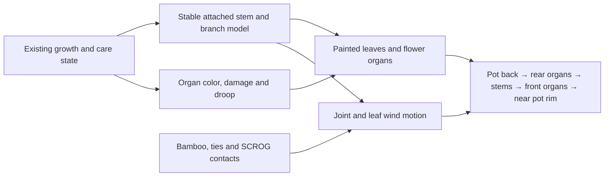

# Porchlight: growth-driven artwork plan

Status: research complete; single-strain design plan. No new strain renderer is installed in production. Nothing in this study has been pushed.

The approved-looking whole-plant sheets establish a useful painted style, but scaling a finished silhouette cannot represent an arbitrary branch structure. The proposed production direction is a plant assembled from painted organs, driven by the existing simulation. Prove that system on Porchlight before commissioning more strains.

## What the game actually does

These findings come from the current `src/game.html`, not instructions in uploaded reference material. Reproduce the browser audit with `node tools/research-plant-growth.cjs`. Measured results and a labeled comparison are in `review/porchlight-research/current-game-behavior.json` and `current-game-behavior.png`.

| System | Current behavior | Requirement for the painted replacement |
| --- | --- | --- |
| Continuous growth | `plantDaily` increments height by stage, health, genetics, phenotype, environment and training. Nodes grow fractionally through Transition, capped at 11. Density also increases. Mature photoperiod vegetation can continue while long-day lighting is retained. | Read actual height and nodes, including partial new-node development. Keep adding/expanding attached organs rather than stretching one stage picture. |
| Main stem and branches | `PlantArt.build` reconstructs shoots from seed, height, nodes, branching trait and phenotype. Side shoots emerge at nodes; shorter young shoots have fewer leaves. The seed makes a given state repeatable, but the save does not contain persistent branch/leaf identities. | Give every node, branch, petiole and leaf a stable identity and a parent attachment. Unchanged branches must not shuffle when another node appears. |
| Leaf anatomy | Cotyledons and first true leaves differ. Later fans have several serrated leaflets joined at a common petiole. Genetics choose broad, hybrid or narrow blades. | Paint appropriate organ types and views. Early seedling leaves must not look like miniature mature seven-leaflet fans. |
| Natural training | Upright central leader and lateral shoots. | Keep the Porchlight bushy, broad-leaf identity, readable internodes and branch junctions. |
| LST | Main leader leans; side shoots spread toward an even canopy. It also reduces subsequent height growth. | Bend joints and keep branch tips connected. Show ties attached to real stems. |
| Topping | With sufficient nodes the rendered leader forks into two tops; later growth has a different height multiplier. | Model a split and the two attached leaders; do not flatten a normal tree picture. |
| SCROG | Shoots spread toward a canopy plane, with a rendered net. | Use the same branches guided through a fixed net, with appropriate front/back crossings and restricted motion at supported points. |
| Bamboo stakes | `staked` adds two background poles and changes yield potential. It does not currently anchor particular branch joints. | Stationary poles, visible ties, reduced movement at tied joints; free leaf tips can still flutter. |
| Lower pruning | `pruned` hides lower shoots and main-stem leaves below a cutoff of about 40% of node count. It reduces density and adds stress. | Remove those attached lower branches/leaves, leaving a readable stem and clean lower silhouette. |
| Shape canopy / defoliation | The action reduces density, adds stress, reduces mold slightly and records `lastDefol`. **The renderer does not read density or lastDefol, so thinning alone produces the same sprite.** Neither field is in the current sprite key. | Make leaf removal visible and persistent. Invalidate the relevant cached art. New growth can increase canopy coverage without making a removed old leaf reappear. |
| Water and stress | Low water, high water, low health and stress affect leaf angles. | Deform petioles and leaves around their attachments rather than dropping or shrinking the entire plant. |
| Yellowing | Low health changes foliage color; low nutrition affects lower/older leaves more. Late-flower fade is separate. High nutrients can produce brown tips. | Blend condition color per organ and age. Preserve the difference between healthy late fade and distressed young growth. |
| Pests, mold and light burn | Existing diagnostic marks are drawn on the plant. | Keep symptoms visible on the appropriate leaves/flowers. Do not silently switch to old pixel art when a plant becomes sick. |
| Sex and flowering | Male pollen-sac clusters differ from female flowers. Flower size, pistil age, sugar leaves, seeded buds and resin change across flowering. | Attach the right flower organs to branch tips/nodes and mature those organs over time. Keep sex/pollination behavior unchanged. |
| Drying / finished harvest | Cut branches hang with a top attachment; drying progress and mold affect their appearance. Finished plants may remain hanging until jarred. | Reuse the plant's cut branches with a top suspension point; support the actual finished-hanging state and the separate jar presentation. |
| Wind | Current drawing offsets horizontal sprite rows; root or hanging point remains anchored. The row motion does not understand stakes, ties, branches or net contacts. | Hierarchical motion: rooted trunk → branch → petiole → leaf. Dampen supported joints; let leaf tips respond more. Honor existing fan/weather amplitude and reduced motion. |
| Other views | Pots, outdoor giant proxies, camera feeds, photos, Codex and seed/cutting previews all use plant art. | The same model and anchor conventions must work everywhere, with accurate pot front/back layers and player occlusion. |

### Audit evidence

The disposable browser check confirmed that lower pruning, stakes, all three training styles, water extremes, stress and low nutrition change the current sprite. Reducing density alone, even with `lastDefol`, does not. A real `plantDaily` call also increased height, fractional node count and density in mature vegetation. Exact values depend on the generated phenotype and environment and are recorded in the report; they are not new balance constants.

## Proposed Porchlight model

1. **Structure comes first.** Build a deterministic parent/child structure using the plant's existing seed, nodes, height, phenotype and training. Derive randomness from each organ ID, not from the number of random calls made while drawing previous branches. Grow new leaves/shoots out of identified nodes and interpolate the existing fractional node progress.
2. **Paint reusable organs.** Commission a Porchlight kit: seed/radicle, cotyledon, single/three/five/seven-leaflet fans with front/side/rear views, petiole/stem/node detail, young sugar leaves, several flower maturities, male sacs/open flowers, bamboo/ties and net detail. Variation comes from assembly, orientation, size and the strain's geometry—not a separate full plant image for every combination.
3. **Keep care effects attached.** Health color and damage are controlled by existing state; droop bends petioles. Supports constrain branch motion. Lower pruning removes the corresponding organs. Defoliation removes selected fan leaves without detaching the remaining ones.
4. **Keep identity as it grows.** New nodes add new organs; older organs remain recognizable. The early/middle/late pictures become checkpoints of a continuous model. The painted concepts remain color, anatomy and silhouette references; seeds/jars and suitable parts can be reused where their shape fits.
5. **Use one rendering path.** Natural, trained, stressed, yellowing and supported Porchlight plants must all use the new artwork. Falling back to old graphics for those ordinary care states is not an acceptable finished result.

### What needs extra state, and what does not

The current simulation already has the inputs needed for growth, training, stress, pruning, stakes and coloring. Do not change growth rates, costs, yields, genetics, watering or thresholds as part of the visual upgrade.

It does **not** remember which individual leaves a defoliation removed. A minimal, versioned visual record is recommended for removed organ IDs and successful care-event positions. Native care handlers should update it only after the original action succeeds. Rendering must remain read-only. Save/load and photo snapshots need to retain this record. Existing saves can reconstruct a stable starting plant from the current seed and flags; no invented historical cuts are required.

Important boundary: `training` is currently one mode, not a cumulative history of all training actions. Bamboo and lower pruning can coexist with a training mode. Modeling irreversible historical topping followed by another style would go beyond faithfully rendering the existing enum; decide that separately before changing game/data semantics.

Canopy density also regrows as a gameplay value. Rendering should use that as a coverage target while keeping removed leaf identities removed. New foliage should emerge from valid live growing points. Precisely simulating botany, branch breakage or individual tissue recovery would require additional gameplay modeling and is outside this first visual pass.

## Approval sequence for one strain

1. **Porchlight structure sheet:** same plant at several heights/node counts, including a held-in-veg large plant. Show branch continuity and anatomically connected leaves. Approve the organ kit and silhouette first.
2. **Care and training sheet:** natural, LST, topped, SCROG; bamboo supports; lower pruning; leaf thinning; dry/wet stress; nutritional yellowing; healthy late fade; damage. Include combinations such as SCROG + pruned + staked + yellowing. Male flowers, drying and finished-hanging states belong in this coverage too.
3. **Motion sample:** growing nodes over time and wind at several strengths, compared with supported/netted plants. Roots, poles and net anchors stay put. Reduced motion freezes the animation. No gaps at joints or disconnected leaf tips.
4. **Actual game verification:** every pot and tent, indoor/outdoor/giant, player depth, night tint, cameras, snapshots, save/load, care actions and asset loading. Verify gameplay state and rates are unchanged. Publish only after user approval.
5. **Then expand the catalog:** apply the proven renderer to the next strains in batches of three. Most new work should be the strain's geometry/leaf proportions, palette and flower character. Shared training, disease and wind systems should not need to be reinvented per strain.

## Saved study material

`graphics/strains/batch-01/` retains three generated whole-cycle sheets and the experimental fixed-stage renderer. `review/strains-batch-01/` retains the still/animated concept samples. They are archived studies, not production assets in use. `tools/preview-strain-concepts.cjs` injects that draft only into a disposable preview page. Production `public/index.html` and its character/art release remain unchanged from the last pushed update.

## Future genetics and expanding the plant-part library

The user has added a long-term requirement: future phenotypes and strains should reuse these organs, and the library should accept additional art and traits over time. The renderer-independent foundation now lives in `graphics/plants/`; it is not installed in the live game.

Existing `Individual115` genome IDs and `PlantTraits115.for` expression are the source of truth. New visual identities select compatible versioned parts from expressed traits, remain stable across saving and cloning, and give offspring their own deterministic variation seed. Do not breed artwork IDs independently of the actual plant's inherited traits.

Inherited appearance and temporary condition are distinct. Broad/narrow leaflet shape and inherited foliage/flower colors belong to the phenotype. Yellowing, water stress, pruning, canopy cleanup, training and stakes alter the current expression of the same plant. Historical removed organs require the separate visual-state record described above.

The initial library registers Porchlight's 15 draft organ roles and validates part compatibility, asset-approval metadata, profile references and attachment requirements. Additional inherited trait descriptors can be registered through data; extending the game's actual inheritance still requires an explicit genetics adapter. New profiles and assets use new revision IDs; old saved plants and clones retain their pinned selections. All seven foundation checks pass. The next artwork milestone remains one complete Porchlight organ kit and growth rig—not another set of whole-plant strain sheets.

## First component/growth milestone

The first Porchlight organ sheet and attached growth prototype now live in `graphics/plants/porchlight/`. A local comparison uses the same phenotype at 50 inches and 90 inches, at the same physical scale. The growth animation adds lateral shoots and leaves while preserving main-node IDs and the native 11-node limit. This is a review-only natural vegetative growth milestone; the full training/care/drying coverage above is still required before a game replacement can ship. Prototype outputs and measured height checks are in `review/porchlight-growth/`. The live game remains unchanged.
