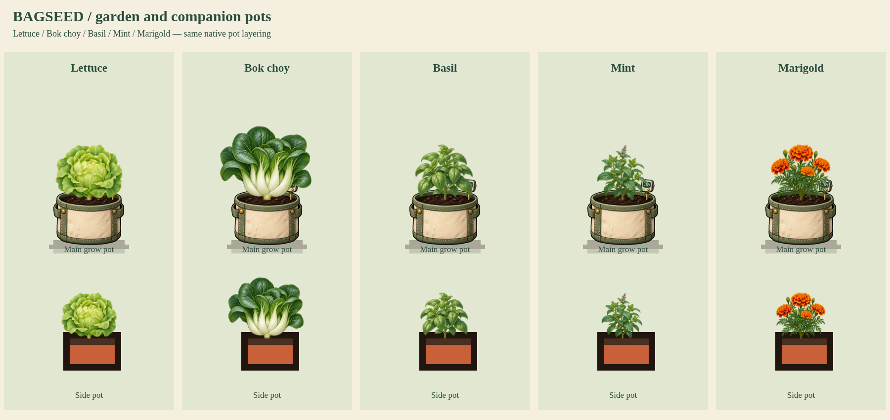

# Garden batch 01: Lettuce, Bok choy, Basil, Mint and Marigold

Status: user-approved production artwork, integrated into index.html.

Native identities: P001, P010, P051, P061, P098. Each has four original painted silhouettes for the actual game stages: sprouting, young, growing, ready/in bloom. Lettuce and bok choy remain leafy harvest crops instead of bolting. Basil has smooth opposite leaves; mint has toothed textured opposite leaves; marigold has divided foliage, closed buds and orange-gold flower heads. Exact original RGBA PNGs are preserved, with lossless RGBA-equivalent WebP. All twenty growth crops are measured separately, nonoverlapping, and attached at inspected central basal stems. Basal anchors target opaque central tissue rather than a lower dangling leaf or transparent edge.

## Samples

- [Four-stage sheets](growth-stages.png)
- [Matching store and inventory packet artwork](store-artwork.png)
- [All three main-pot tiers](pot-tiers.png)
- [Native 5×5 tent example](tent-example.png)
- [Eight-second growth/wind MP4](growth-and-wind.mp4)

## Shared renderer

`graphics/garden-plants/sources/renderer.js` adapts GPArt.draw and GPArt.icon for just these five IDs. Other species retain their existing renderer. It uses high-resolution cached surfaces, an eight-frame-per-second wind update, and a bounded 64-surface cache. Gentle upper-foliage strip deformation has zero root displacement; reduced motion selects a still surface. Existing four-stage progression, native heights, planting eligibility, care, harvest/regrowth and companion bonuses remain simulation-owned.

The old main-pot rosette lift is canceled only while the native RoomArt.drawSlots chain draws the new plants. The corrected basal stem sits at the original soil coordinate and the existing main-pot rim remains in front. Companion examples use the native Companion.draw path and current side pots. Their pot artwork itself is unchanged. Store packet artwork uses the same mature plant. No rare variety is silently assigned these default art identities.

The review adds the adapter only to a disposable browser page for current index.html and routes draft images from the review folder. Published HTML, production assets, approved character payload and current startup code remain unchanged. The five approved atlas hashes are registered in production, and startup now awaits BagseedGardenPlants.ready. All three release browser tests passed.

## Verification

`node tools/preview-garden-batch-01.cjs` passes: twenty finite growth-stage geometries and in-bounds central anchors, wind changes and root-fixed displacement for all five, stable reduced-motion frames, native full-size pot layers and side-pot draw paths, biology unchanged by drawing, untouched-species fallback rendering identical, save/reload with adapter reinstallation, and no browser errors. Existing `npm run check` passes. The compiler verifies four separated stages per source and exact decoded RGBA equality. The clip contains 96 frames at 12fps (eight seconds); growth stage changes are selected review inputs rather than eight seconds of simulated gardening.

Reproduce each atlas with `python3 tools/compile-garden-review.py lettuce /workspace/generated_images/<generatedSource>` (use the kit manifest's key and original generatedSource for each of the five). Render using `node tools/preview-garden-batch-01.cjs`.
