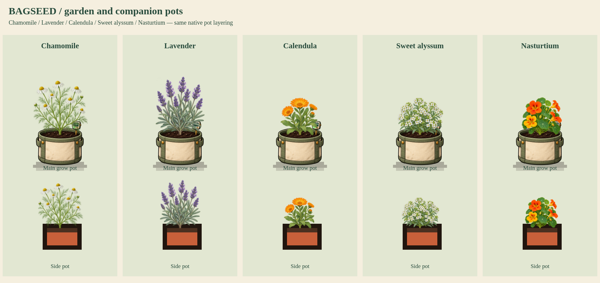

# Garden batch 02: Chamomile, Lavender, Calendula, Sweet alyssum and Nasturtium

Status: user approved; integrated into the production game. The approved first five species were published as `02ae556`.

Native IDs: P070, P126, P151, P108, P105. Four native growth stages per plant: sprouting, young, growing, ready/in bloom. Native height, season, planting eligibility, care, harvest, regrowth and companion modifiers are unchanged. All five support both main grow pots and companion pots.

The botanical targets are fine threadlike Chamomile foliage with white/yellow daisies; narrow sage-gray Lavender leaves and violet spikes; simple spoon-shaped Calendula leaves and orange daisies; narrow-leaved Sweet alyssum with tiny four-petaled white flowers; and Nasturtium's round peltate leaves with five-petaled orange/yellow flowers. Calendula's lower hanging leaves are excluded from basal attachment selection using inspected source-pixel anchors for stages 2 and 3 in its attachment-points.json.

The approved `renderer.js` uses the same root-fixed wind, bounded frame cache and reduced-motion stills as the released renderer. It adds a starter-pot store illustration for Lavender, matching the native starter purchase form; the four seed species retain botanical packet artwork. The renderer is now compiled into production index.html with all ten approved garden species. Exact approved atlases are published at hashed asset URLs, and startup waits for all ten. The review command below still uses an isolated draft adapter.



- [Four-stage sheets](growth-stages.png)
- [Store artwork](store-artwork.png)
- [Three main-pot tiers](pot-tiers.png)
- [Native tent example](tent-example.png)
- [Eight-second growth and wind MP4](growth-and-wind.mp4)

Render with:

```sh
node tools/preview-garden-batch-01.cjs --review-root=review/garden-batch-02 --keys=chamomile,lavender,calendula,alyssum,nasturtium --renderer=review/garden-batch-02/renderer.js
```

Atlas measurement uses `python3 tools/compile-garden-review.py <key> /workspace/generated_images/<generatedSource> --review-root=review/garden-batch-02`. Each original source PNG is retained. Four separate growth crops, opaque basal anchors and lossless RGBA-equivalent WebP are checked. Additional source-pixel anchors are validated on opaque central stem pixels rather than inferred from lower leaf tips.

Validation passed: twenty finite growth-stage geometries with in-bounds opaque central basal anchors; all five animate with fixed roots and remain still with reduced motion; native main-pot rims and companion-pot paths; all three main-pot tiers; unchanged biological plant data when drawing; untouched species fallback identical; saved plants reload with the review adapter reinstalled; no browser errors. `npm run check` passes for the unchanged published game. The MP4 is 96 frames at 12fps, eight seconds, with selected stage changes rather than eight seconds of simulated cultivation.

Inspect the browser-composited preview before judging raw RGBA thumbnails: almost-transparent RGB pixels between fine leaves can look opaque in some image viewers. The selected Chamomile source is `exec-c8d2a8fa-a91b-46ae-9a1c-6a50f0272e62.png`; its native composite displays fine divided foliage. Original generated PNGs are never repainted.

Production release validation: build and static integrity checks passed; all four browser tests passed (both garden batches, live cannabis/genetics/mutations regression, mobile plant resolution/camera regression). Both garden tests held all ten atlas requests to verify the startup cover waits, then checked wind, reduced motion, root alignment, unchanged biology and saved-plant reloads. Character payload retained unchanged by the build.
