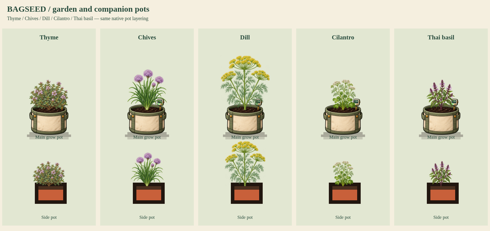

# Garden batch 03: Thyme, Chives, Dill, Cilantro and Thai basil

Status: user approved; integrated into the production game.

Native IDs: Thyme P058, Chives P056, Dill P055, Cilantro P053, Thai basil P052. Each has four native growth stages and supports main pots and companion pots. Thyme and Chives retain their starter purchase form; the other three retain seed packets. Native heights, growth times, planting eligibility, care, harvest, regrowth and companion bonuses remain unchanged.

Botanical targets: Thyme has tiny opposite gray-green leaves on a low woody cushion and light lilac-pink flowers. Chives form a fountain of hollow tubular leaves with purple pompom umbels on separate scapes. Dill has finely divided threadlike foliage and yellow compound umbels. Cilantro combines broad lobed basal leaves with finer upper foliage and small white compound umbels at bolting. Thai basil has pointed narrow green leaves, opposite leaf pairs, purple stems and lavender flowers on purple bracts.

Source PNGs are retained unchanged. Isolated four-stage crops and central basal attachment points are measured into per-species manifests, with lossless runtime WebPs. The approved renderer is compiled into production index.html with all fifteen approved garden species. Exact approved atlases are published at hashed URLs, and startup waits for all fifteen. The review command below still injects a draft adapter into a disposable browser session. Root-fixed wind and reduced-motion stills use the existing shared rendering method.

Review command:

```sh
BAGSEED_BROWSER_PATH=/usr/bin/chromium node tools/preview-garden-batch-01.cjs --review-root=review/garden-batch-03 --keys=thyme,chives,dill,cilantro,thaibasil --renderer=review/garden-batch-03/renderer.js
```



- [Four-stage growth sheets](growth-stages.png)
- [Matching store artwork](store-artwork.png)
- [Eight-second growth and wind animation](growth-and-wind.mp4)
- [Three main-pot tiers](pot-tiers.png)
- [Native tent example](tent-example.png)

Validation passed: twenty finite stage geometries with opaque central basal anchors; five wind animations with fixed roots and reduced-motion stills; main-pot rim layering and native companion drawing; all three main-pot tiers; unchanged biological data during drawing; untouched-species fallback identical; saved plants reload with the review adapter reinstalled; no browser errors. Atlas compiler verifies four isolated stages and exact decoded RGBA equality for each runtime WebP. Sample capture left published files unchanged; approved integration subsequently registered the five new atlases in production. Static integrity checks pass. The clip is 96 frames at 12fps, eight seconds; growth stages are selected sample inputs, not eight seconds of simulated cultivation.

Inspect browser-composited previews when judging fine foliage: almost-transparent RGB between tiny leaves can look opaque in some raw image viewers. Source pixels are retained without repainting.

Production release validation: build and static integrity checks passed; all five browser tests passed (three garden batches, live cannabis/genetics/mutations regression, mobile resolution/camera regression). Startup waits for all fifteen garden atlases; character payload retained unchanged by the build.
