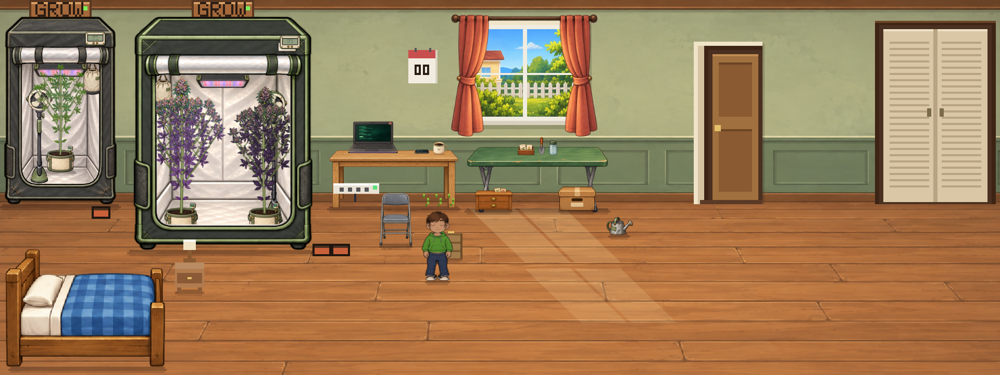

# Approved plant art connected to the actual game

The earlier commits supplied approved component kits and review captures but did not replace the native pixel renderer. This update installs the production compositor in **public/index.html** and connects it to native `PlantArt.build/get/draw`, so existing and new plants use the painted components in live room scenes, outdoor scenes, plant inspectors, cameras, Sprout photos, codex/seed-library previews, mutation cards and drying displays.

[Mobile gameplay](mobile-game.png) · [Plant inspector](inspector-live.png) · [Sprout photo](sprout-live.png) · [Mutation visuals](mutations-live.png)

## Native compatibility

- All 14 approved atlases are hash-verified by the compiler and awaited by the loading cover. An asset failure keeps the existing reload/error cover instead of revealing a partial release.
- A persistent visual recipe chooses leaf anatomy/foliage and flower color separately from each plant's expressed native traits. This covers the original 12 names, the additional seed-library catalog, bag seed and generated crosses without changing genes or assigning every plant Porchlight's appearance.
- `paintArt115` schema v1 stores donor kits, phenotype seed and actual expressed traits. Save/load, clones and photos retain it. Older saves receive recipes at normal post-load/save boundaries; recipes contain no canvas pixels and never overwrite biology.
- The shared model retains physical growth, stable attached branch IDs, graded popcorn bud sites and native canopy cleanup. Topping and Twin Leader have two actual connected leaders, with their own leaves and flower sites. LST spreads/bends, SCROG spreads branches and draws its support net, bamboo stakes/ties damp wind.
- Water/stress droop, low-food/poor-health leaf color, burnt tips, pests, mold and dry progress remain visible. Natural senescence and genotype-gated cool-night pigment remain separate from nutrition.
- All 15 native mutation genes are preserved. Source art receives matching foliage masks, palettes and structural changes for fern/freak leaves, webbed fans, single blades, variegation, albino tips, gold/ink color, ember stems, pink pistils, twin leaders, crested flowers, whorls, dwarf leaves and triploid bulk.
- Sprites render at 3× resolution with logical native dimensions. Ordinary native callers keep their size/anchor contract; unsized thumbnail/camera draws were given explicit logical sizes. The native soil → plant → near-rim sequence, tent fabric/player depth, post-tint smart-pot LEDs, collision and interaction placement remain intact. Outdoor giant proxies retain inherited plant properties.
- A bounded 384-entry component texture cache and 8-fps attached-wind frames avoid redrawing the full plant for every display frame. Reduced motion stays still. The current browser report records timing for eight warm wind frames; it is a local functional measurement, not a mobile device benchmark.

## Validation

- Existing 68 component, identity, growth, cleanup and color unit tests pass. Two new model tests cover foliage/flowers on both leaders, trained branch geometry, whorls and inherited proxy properties.
- The new browser test loads production `index.html` with all plant requests held back, verifies the cover stays visible, then releases all 14 atlases. It checks painted rendering for all 38 initial genetics records, an additional generated cross, every growth/drying stage, all 15 mutations, four training forms, stress symptoms, attached wind, pot layers, copied photo identities, clone pinning, save/reload and a pre-update save without a recipe. No browser errors.
- Existing native mutation inheritance, night-cooling/color, canopy-care, water/pot integration, tent/player depth, loading-first-paint and loading/error-recovery tests pass.
- `npm run check` verifies the baseline, generated source/output hashes and latest **character-audit-cel-v1** payload. The latest character and heritable mutation updates from `origin/main` were retained.

Reproduce: `npm run build:bedroom`, `npm run check`, `node --test tests/live-plant-model.test.cjs tests/live-plants-browser.test.cjs`, plus the relevant native regression suites listed above.

The files here are captures of native game rendering; they do not inject the prototype renderer into a disposable review page. Earlier kit approval boards remain references for the component artwork.
