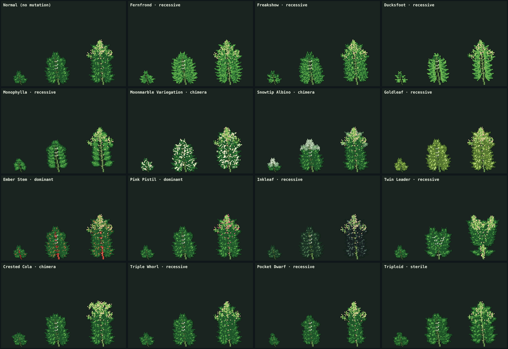
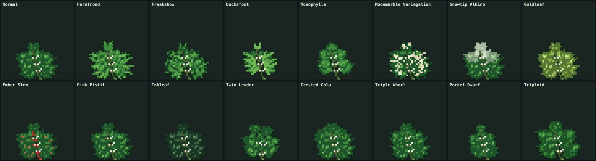

# Mutation artwork and genetics

Rare mutations are now genes. Clones keep them, and you can breed them into other lines.

Regenerate both sheets from the live renderer with `node tools/preview-mutations.cjs` after `npm run build:bedroom`.

## Catalog (15 traits, 7 new)

| Trait | Inheritance | Look |
|---|---|---|
| Fernfrond | recessive | lacy, deeply notched leaflets |
| **Freakshow** (new) | recessive | fern fronds: every leaflet carries a comb of sub-leaflets |
| **Ducksfoot** (new) | recessive | webbed leaflets fused into one smooth pad with visible veins |
| **Monophylla** (new) | recessive | single smooth blades, no leaflets |
| Moonmarble Variegation | chimera | marbled cream sectors, whole ghost leaves and streaks |
| **Snowtip Albino** (new) | chimera | ghost-white new growth that greens with age |
| Goldleaf | recessive | lime-gold foliage with brighter highlights |
| Ember Stem | dominant | crimson stems, petioles and now leaf veins |
| **Pink Pistil** (new) | dominant | hot-pink pistils that age to coral |
| Inkleaf | recessive | near-black leaves deepening with maturity |
| Twin Leader | recessive | self-topping main stem |
| **Crested Cola** (new) | chimera | fasciated ribbon stem, extra apex shoots, wide wavy top cola |
| Triple Whorl | recessive | three leaves per node |
| Pocket Dwarf | recessive | small, compact |
| **Triploid** (new) | sterile | oversized, broad, dark leaves and chunkier buds |

## How the genetics work

- Each plant's saved genome (`genome115.mg`) records 1 or 2 copies of each seed-borne trait. Tissue traits go in `genome115.som`. The phenotype is always read from the genome.
- **Clones** copy the genome exactly, so a cutting always shows its mother's mutations. A clone's reveal is quiet and isn't counted as a new discovery.
- **Recessive** (Freakshow, Ducksfoot, …): crossing to a plain plant gives 100% hidden carriers. F1 × F1 gives about 25% that show the trait. A backcross to the mutant mother (or her clone) gives about 50%.
- **Dominant** (Ember, Pink Pistil): one copy shows, so about 50% of seeds show it when crossed to a plain plant.
- **Chimera** (Moonmarble, Snowtip, Crested): cuttings keep it. Seeds inherit it only about 12% of the time, and only through the mother.
- **Sterile** (Triploid): no pollen and no seed set. Cuttings are the only way to keep it.
- Seedlings record pedigree carrier odds (for example, "67% carrier"). Seed lots list the expected show/carry percentages per seed. New catalog seeds sometimes carry a hidden recessive, and seeds rarely get a brand-new spontaneous mutation.
- Older saves migrate on load: an expressed trait becomes its gene with no reroll.

Covered by `tests/mutation-genetics.test.cjs`.
