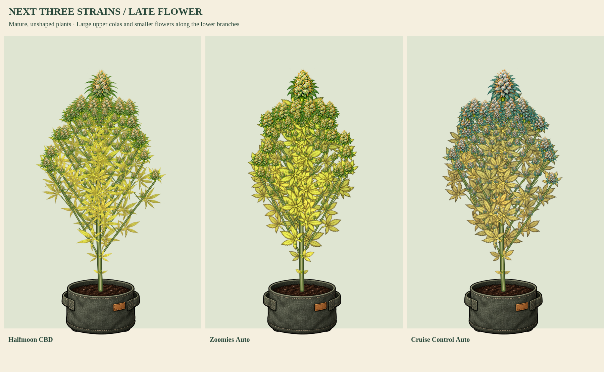

# Halfmoon CBD / Zoomies Auto / Cruise Control Auto

Status: review samples awaiting approval. Saved locally; not pushed.

| Strain | Growth cycle | Wind animation |
| --- | --- | --- |
| Halfmoon CBD | [Seed through harvest-ready](../halfmoon-components/halfmoon-growth-and-flower.png) | [10-second MP4](../halfmoon-components/halfmoon-growth-and-wind.mp4) |
| Zoomies Auto | [Seed through harvest-ready](../zoomies-components/zoomies-growth-and-flower.png) | [10-second MP4](../zoomies-components/zoomies-growth-and-wind.mp4) |
| Cruise Control Auto | [Seed through harvest-ready](../cruise-components/cruise-growth-and-flower.png) | [10-second MP4](../cruise-components/cruise-growth-and-wind.mp4) |

Halfmoon has long narrow lime fans and slender citrus-green flowers. Zoomies has fuller hybrid lime fans, chunky buds and ginger pistils. Cruise Control has blue-green hybrid fans, mint-blue flowers and apricot pistils. Finishing leaves show gold, gold and ochre respectively. Cruise Control's existing receptive genotype also has a [cool-night color comparison](../cruise-components/cruise-cool-night-colors.png). Green-only Halfmoon and Zoomies do not gain cold pigment or a color viral bonus.

All samples use the shared connected model, graded branch/popcorn buds, persistent canopy cleanup, natural senescence and root-fixed wind. Actual height drives geometry; no second application of native height factors. The combined portrait holds height and stage equal to compare morphology and palettes. Native autoflower timings, size factors and training stress are unchanged. Fifty/ninety-inch boards are physical-scale review inputs, not normal indoor auto growth predictions.

Validation completed:

- 44 unit tests across the component kits, shared growth/cleanup, phenotype identity and cool-night color.
- New three-kit tests check every earlier published part/profile against its prior checksum, stable saved/clone identities, organ bounds/hashes, narrow/hybrid compatibility, growth, flowers, cleanup, wind and genetically eligible senescence.
- Three browser captures from current `index.html`, no browser errors, measured painted height within 0.6 inches of the 50/90-inch labels.
- Each MP4/GIF contains 120 frames, 12 fps, 10 seconds. Both the final-height giant and mature flowering canopy change between wind frames, while the ground landmark remains fixed. Root attachment is also verified in model tests.
- `npm run check` passes; production index and character payload remain unchanged.

Reproduce: `node tools/preview-popcorn-canopy.cjs --next-three`, `node tools/preview-plant-components.cjs <strain>`, `python3 tools/verify-plant-wind.py halfmoon zoomies cruise`.

These are component-kit review prototypes. Full native painted-renderer replacement still awaits the broader care/training, diagnostic, camera and depth integration described in each strain's README.
