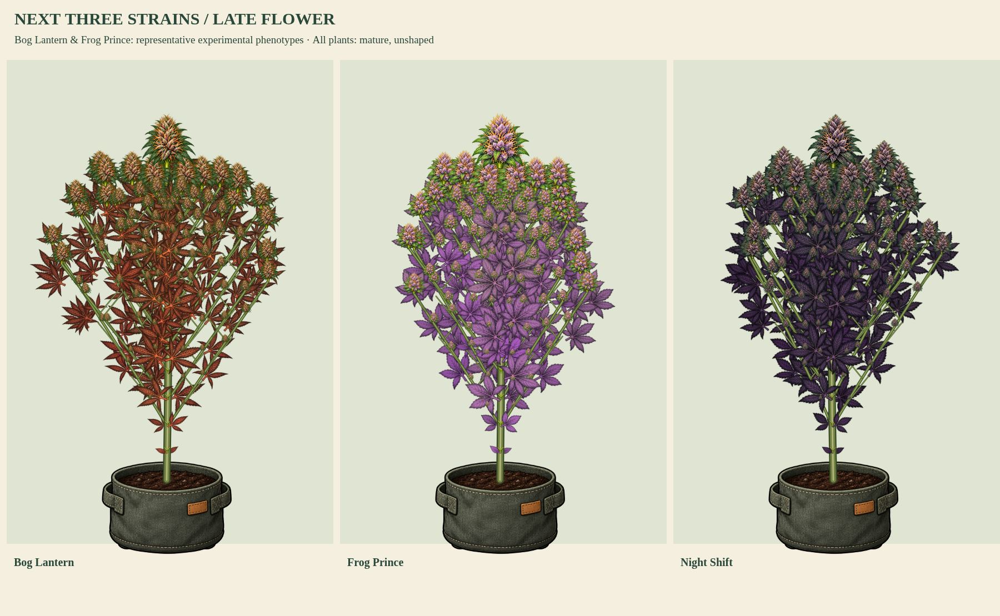

# Bog Lantern / Frog Prince / Night Shift

Status: artwork, growth cycles, color shifts and wind samples approved on 2026-10-17.

| Strain | Growth cycle | Wind animation |
| --- | --- | --- |
| Bog Lantern | [Seed through harvest-ready](../boglantern-components/boglantern-growth-and-flower.png) | [10-second MP4](../boglantern-components/boglantern-growth-and-wind.mp4) |
| Frog Prince | [Seed through harvest-ready](../frogprince-components/frogprince-growth-and-flower.png) | [10-second MP4](../frogprince-components/frogprince-growth-and-wind.mp4) |
| Night Shift | [Seed through harvest-ready](../nightshift-components/nightshift-growth-and-flower.png) | [10-second MP4](../nightshift-components/nightshift-growth-and-wind.mp4) |

Bog Lantern shows slender forest-green fans, russet/copper flowers and red finishing leaves. Frog Prince shows broad lime-green fans, chunky grape flowers and purple finishing leaves. Night Shift follows its fixed broad forest/Dark purple catalog traits, with inky calyces, silver frost and deep-plum senescence. All three have separate natural/10°F cool-night color comparisons in their review folders.

Bog Lantern and Frog Prince are experimental lines whose native traits roll per save. The chosen review expressions are examples, not new fixed defaults. This batch neither changes nor reveals native genetics. Their parts constrain compatible leaf shape, leaf palette and flower palette, so an incompatible experimental roll is rejected explicitly instead of silently receiving this appearance. Future phenotype families can be registered with new part/profile IDs. Earlier eight kits and saved identities remain pinned.

The shared model supplies continuous attached growth, graded branch/popcorn buds, persistent canopy cleanup, root-fixed wind, reduced motion and phenotype-aware senescence. The comparison holds plants at the same 50-inch height and stage. Fifty/ninety-inch boards are controlled physical-scale inputs, not changes to native size or autoflower timing. Full painted-renderer replacement still awaits complete care/training, diagnostic-state, drying-organ and native camera/depth integration.

Validation:

- 56 unit tests pass, including new three-kit bounds, hashes, phenotype compatibility, expansion, branch buds, cleanup, wind and finishing-color checks.
- Every earlier published part/profile record retains its prior checksum; saved and cloned identities remain stable.
- Experimental compatibility tests verify that the native catalog still rolls these lines and unsupported palette/shape combinations are not silently substituted.
- All three compilers pass RGBA-exact WebP and nonoverlapping crop checks, including a repeat compilation that preserves existing part IDs. Bog Lantern's first sheet failed spacing; it was rerendered rather than relaxing validation.
- Browser samples load current `index.html`, with no errors, measured 50/90-inch canopy bounds, and 120-frame growth/wind clips. Video and fixed-ground checks are recorded in the per-strain reports.
- `npm run check` passes. Native source, production entry and character payload are unchanged.

Reproduce:

- `node tools/preview-popcorn-canopy.cjs --swamp-three`
- `node tools/preview-plant-components.cjs <boglantern|frogprince|nightshift>`
- `python3 tools/verify-plant-wind.py boglantern frogprince nightshift`
