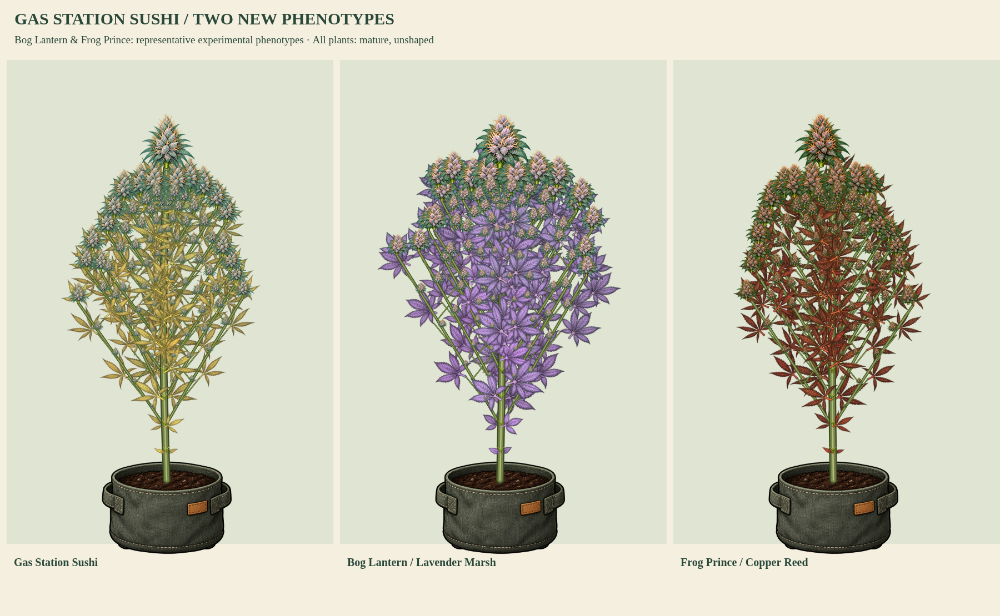

# Gas Station Sushi and two experimental phenotype options

Status: artwork, growth cycles, color shifts and wind samples approved on 2026-10-17; user requested the push.

The user explicitly chose additional experimental phenotypes after the catalog audit found only Gas Station Sushi unfinished. This batch completes the twelve named catalog kits and adds two extra compatible profiles of existing native lines.

| Artwork profile | Native line | Growth cycle | Wind |
| --- | --- | --- | --- |
| Gas Station Sushi | `gasstation` | [Seed through harvest-ready](../gasstation-components/gasstation-growth-and-flower.png) | [MP4](../gasstation-components/gasstation-growth-and-wind.mp4) |
| Lavender Marsh | `boglantern` | [Seed through harvest-ready](../boglantern-lavender-components/boglantern-lavender-growth-and-flower.png) | [MP4](../boglantern-lavender-components/boglantern-lavender-growth-and-wind.mp4) |
| Copper Reed | `frogprince` | [Seed through harvest-ready](../frogprince-red-components/frogprince-red-growth-and-flower.png) | [MP4](../frogprince-red-components/frogprince-red-growth-and-wind.mp4) |

Gas Station Sushi has narrow blue-green foliage, frosty mint-blue flower spears and ochre senescence. Bog Lantern's Lavender Marsh phenotype has broad sage-blue fans, lilac flowers and lavender senescence. Frog Prince's Copper Reed phenotype has narrow forest fans, russet/copper flowers and red senescence. Each includes a natural versus qualifying cool-night color study. The shared threshold, exposure accumulation and genotype-gated Sprout color bonus are unchanged.

Variant registration preserves the native line ID and sets `registerAsDefault: false`. There are twelve `library.strains` entries and fourteen profiles: no fake strain names, no changes to earlier default profiles, saved appearances or player genetics. The existing identity helper's explicit `profile` option selects a compatible alternate; saved plant/clone identities stay pinned even if a different profile is later requested. Experimental parts constrain shape, foliage palette and flower palette and reject incompatible traits. Automatic native phenotype-to-profile selection remains a future integration step.

All samples use the shared connected model: expanding attached branches, graded branch/popcorn buds, persisted canopy cleanup, fixed-root wind, reduced motion, natural senescence and eligible cool-night color. Heights in the 50/90-inch boards are physical-scale review inputs, not changes to native height factors or autoflower timing. The combined portrait holds height and stage equal. Full painted-renderer replacement still needs the remaining care/training, diagnostic-state, drying-organ and camera/depth integration described in each kit README.

Validation:

- 68 unit tests pass across all kits and the shared identity/growth/cleanup/color systems.
- New batch tests verify earlier eleven part/profile records against their pre-change checksum, native catalog/default stability, variant ancestry, explicit profile selection, clone/save pinning, measured organ bounds/hashes, flowers, expansion, cleanup and wind.
- All three atlas compilers pass exact RGBA WebP and crop checks; repeated compilation preserves previously registered parts.
- Browser samples load current `index.html` without errors, measure actual painted bounds at 50/90 inches, and export 120-frame / 12-fps / 10-second growth-and-wind clips.
- Per-strain wind reports verify both final-height canopies move while the ground landmark remains fixed; model tests verify fixed root attachments.
- `npm run check` passes. Native game source, production HTML and character payload remain unchanged.

Reproduce: `node tools/preview-popcorn-canopy.cjs --final-three`, `node tools/preview-plant-components.cjs <profile-id>`, `python3 tools/verify-plant-wind.py gasstation boglantern-lavender frogprince-red`.
