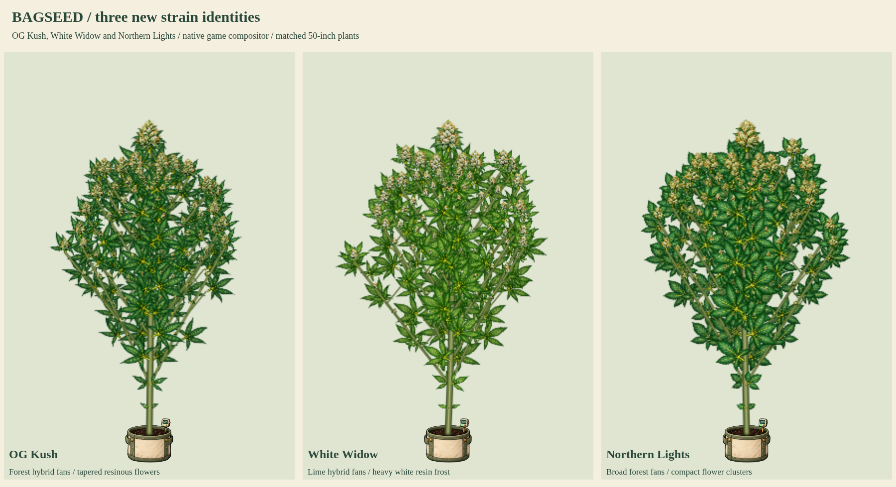

# OG Kush, White Widow and Northern Lights

Status: **user-approved and integrated into the production build**.

This resumes dedicated strain artwork for the expanded catalog. The catalog contains 37 named strains plus generated Bag Seed. Twelve named strains already have approved dedicated kits, with two additional experimental phenotype kits. These three new kits cover existing `cl_ogkush`, `cl_whitewidow` and `cl_northernlights` identities; they do not add strains or change genetics. This integration brings dedicated coverage to 15 of 37 named strains, leaving 22. The fifteen mutation families are a separate category.

## Artwork to review



- [Flower detail](flower-detail.png)
- [Vegetative identities](vegetative-identities.png)
- [Late-flower senescence](late-flower-senescence.png)
- Full cycles: [OG Kush](ogkush-growth.png), [White Widow](whitewidow-growth.png), [Northern Lights](northernlights-growth.png)
- [50-inch potted and 90-inch outdoor models](50-and-90-inches.png)
- [Bamboo, SCROG, cleanup and stress](care-and-training.png)
- [Growth and wind MP4](growth-and-wind.mp4) / [GIF](growth-and-wind.gif)

Each kit contains sixteen original painted organs: seed, radicle, cotyledon, single/three/five/seven-leaflet fans, sugar leaf, stem, Y junction, early/mid/late female flowers, closed/open male flowers and bamboo. Exact source PNGs, measured attachment points, alpha hulls and lossless RGBA-exact WebP are retained under `kits/`.

| Existing strain | Painted identity | Current native finishing color |
| --- | --- | --- |
| OG Kush | Forest-green hybrid fans, tapered olive flower clusters, resin and rust-orange pistils | Golden fan senescence |
| White Widow | Lime-green hybrid fans, heavier milky trichome frost on bracts and sugar leaves | Golden fan senescence |
| Northern Lights | Broad forest-green fans, rounded dense calyx clusters, amber pistils | Golden fan senescence |

These are game-art interpretations of the native catalog traits, not a claim that every real cultivar phenotype has identical anatomy. None of these three native default phenotypes is purple; no new cool-night pigment eligibility is introduced. Existing gene-driven variation, mutation artwork, night-color rules and Sprout behavior remain available through the shared renderer.

## Native renderer preview and production integration

The preview tool replaces only the live plant script in a disposable browser response for the current `public/index.html`. It adds the three pending manifests to the existing fourteen kits and retains all seventeen mutation atlases. Draft WebP requests are served from this review directory. That original sample mode leaves the published game unchanged. The `--production` mode now verifies the actual built page without response replacement or draft asset routes. The exact approved kits are installed under `graphics/plants/`, registered under their native `cl_` IDs and published through the existing external-image pipeline.

The same native recipe resolver automatically selects each new kit for a new plant of its matching line. The three living native lines upgrade matching saved donor parts at create/load/save boundaries without rerolling seeds or genes. Incompatible expressed traits retain compatible donor parts. Historical photos and unrelated saved recipes remain pinned. The actual `PlantArt` compositor supplies leaves, flowers, soil/rim layering, attached branches, support, SCROG, care, wind, mutations, drying/jar stages and inspector detail. No separate whole-plant painting is pasted onto the game.

The full-cycle boards show selected stages from seed to harvest readiness, with early stages enlarged for inspection. The comparison and 50/90-inch boards use explicitly stated matched physical scales. The eight-second clip uses selected review stage/height inputs; it is not eight seconds of simulated crop growth. Height, branching simulation, native timing, yields, sex, inheritance, pruning balance and climate behavior are unchanged.

## Verification

The native browser capture checks all thirteen renderer stages per strain, automatic dedicated leaf/flower selection, connected attachments, graded apical/lateral/popcorn flowers, 50/90-inch expansion, four training modes, larger retained tops after lower cleanup, stress, both flower sexes, fixed-root wind, reduced motion, all fifteen mutation types on each strain, cloned and photographed visual recipes, genome/recipe save-and-reload stability, and preservation of an older pinned donor recipe. Sources and native plants are checked for unintended changes. No browser JavaScript errors were recorded.

`npm run check` and fifteen shared growth/canopy/night-color tests passed. The atlas compiler verifies exact RGBA WebP equivalence and nonoverlapping measured crop rectangles. Production checks additionally verify old living saves upgrade to the new parts, preserve seed/traits/genome/height and remain stable on repeated migration. The production character payload from current main is retained. Detailed results are in [verification.json](verification.json); provenance and file hashes are in [review-manifest.json](review-manifest.json).

Reproduce:

```sh
python3 tools/compile-plant-components.py ogkush --review-only
python3 tools/compile-plant-components.py whitewidow --review-only
python3 tools/compile-plant-components.py northernlights --review-only
node tools/preview-strain-batch-06.cjs --animate
```

The user approved this batch and requested merging/pushing it on 2026-10-19. Release checks target all 34 plant atlases and retain the latest character/outfit and gear-moving updates from main. Reproduce production verification with `node tools/preview-strain-batch-06.cjs --production --out=/tmp/bagseed-strain06-production`. The next requested individual strain is Skunk #1; Afghani and Hindu Kush follow in catalog order.
