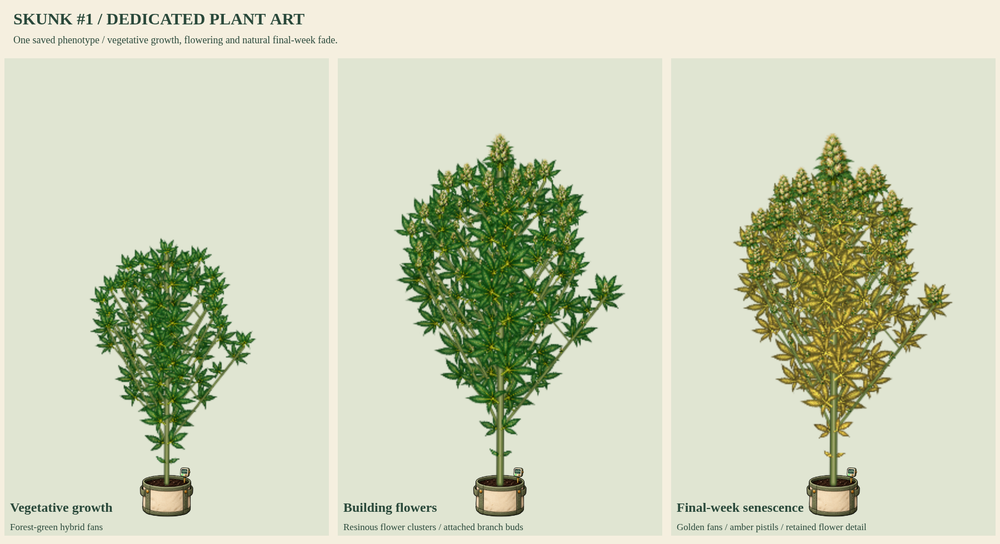

# Skunk #1 dedicated strain artwork

Status: **user-approved and integrated in the production build**. The prior OG Kush, White Widow and Northern Lights update was integrated with current main and pushed as `c2d741f`. This individual strain follows the user's latest request to start the next strain. Afghani and Hindu Kush follow in catalog order.



- [Flowering detail](flower-detail.png)
- [Seed through harvest-ready](skunk1-growth.png)
- [50-inch and 90-inch models](50-and-90-inches.png)
- [Bamboo, SCROG, lower cleanup and stress](care-and-training.png)
- [Eight-second growth and wind MP4](growth-and-wind.mp4) / [GIF](growth-and-wind.gif)

Native line `cl_skunk1` retains its existing hybrid/forest/Forest green traits and branching 1.05. New source art supplies forest-green palmate fans, elongated olive flower clusters, ivory-to-amber stigmas and resinous sugar leaves. Existing natural senescence supplies golden final-week fan leaves; no purple phenotype or new cool-night eligibility is invented. This is an artistic interpretation of the native game phenotype, not a diagnostic botanical promise about every real Skunk #1 plant.

Sixteen original source components cover seed, radicle, cotyledon, single/three/five/seven-leaflet fans, sugar leaf, stem, junction, three female flowering stages, two male stages and bamboo. Source PNG pixels are retained, with measured connected-component crops, anchors, alpha hulls and verified RGBA-exact WebP. No source artwork was repainted by the compiler.

The original preview replaced only the live plant script in a disposable response for current `index.html`, loading eighteen base kits and seventeen mutation atlases. The approved exact source kit is now integrated into the production build; `production:true` capture verifies the real page without preview routing. The native recipe resolver selects Skunk #1 for a matching new plant. The production integration registers native `cl_skunk1`, upgrades compatible living saved plants and retains the latest character payload and game source. No simulation genetics or native catalog entries are changed.

Checks passed for thirteen renderer stages, physical 50/90-inch expansion, graded upper/lateral/popcorn buds, connected branches, lower cleanup and larger retained tops, four training modes, supports, stress, both flower sexes, fixed-root wind, reduced motion, all fifteen mutations, cloned/snapshotted recipes, save/reload, read-only biological state and existing pinned donor recipes. There were no browser JavaScript errors. The clip has 96 frames at 12fps (8 seconds); stages/heights are selected review inputs, not eight seconds of simulated cultivation. Early source organs and seedlings are enlarged in the cycle sheet for inspection.

Reproduce the atlas:

```sh
python3 tools/compile-plant-components.py skunk1 --review-only --review-root=review/strain-batch-07
```

Reproduce native capture:

```js
require('./tools/preview-strain-batch-06.cjs')({
  reviewRoot: require('node:path').resolve('review/strain-batch-07'),
  kitKeys: ['skunk1'],
  animate: true
});
```

The user approved and requested pushing this kit on 2026-10-19. Dedicated production coverage is now 16/37 named strains, with 18 base and 17 mutation atlases. The next requested batch is Afghani, Hindu Kush and Bubba Kush.
