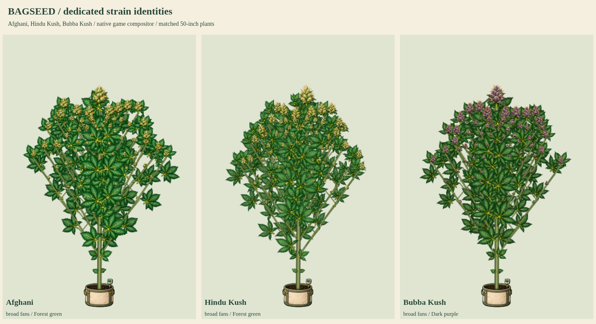

# Afghani, Hindu Kush and Bubba Kush

Status: **user-approved and integrated into the production build**. The preceding approved Skunk #1 update was integrated and pushed as `2e2ac31`. This batch covers the next three existing native catalog strains, with no new catalog entries or changes to genetic/simulation values.



- [Flowering detail](flower-detail.png)
- [Late-flower senescence](late-flower-senescence.png)
- [Natural versus cool-night color](cool-night-colors.png)
- Full cycles: [Afghani](afghani-growth.png), [Hindu Kush](hindukush-growth.png), [Bubba Kush](bubbakush-growth.png)
- [50-inch potted and 90-inch outdoor models](50-and-90-inches.png)
- [Supports, SCROG, lower cleanup and stress](care-and-training.png)
- [Eight-second growth and wind MP4](growth-and-wind.mp4) / [GIF](growth-and-wind.gif)

## Native identities and artwork

| Existing line | Dedicated painted parts | Existing finishing response |
| --- | --- | --- |
| `cl_afghani` / Afghani | Broad forest-green fans, rounded resinous olive flower clusters | Golden fan senescence; no cool-night purple eligibility |
| `cl_hindukush` / Hindu Kush | Tapered broad forest-green fans, compact conical olive flower clusters | Golden fan senescence; no cool-night purple eligibility |
| `cl_bubbakush` / Bubba Kush | Broad green fans, chunky dark-plum bracts, frosted sugar leaves and copper stigmas | Deep-purple fan senescence; existing qualifying cool nights deepen near-black purple |

These are game-art interpretations of the actual native categorical traits, not a promise that every real cultivar has identical appearance. Branching values remain 1.15 / 1.1 / 1.1 respectively. The renderer uses actual saved height without multiplying native height factors a second time. Each kit contains sixteen original source organs: seed, radicle, cotyledon, single/three/five/seven-leaflet fans, sugar leaf, stem, Y junction, three female flower stages, two male flower stages and bamboo. Source PNG pixels are retained; measured connected-component crops, attachment anchors, alpha hulls and RGBA-exact lossless WebP are recorded in each manifest.

Bubba Kush source fan leaves remain healthy green. Its native Dark purple flowers are painted plum; the shared renderer handles final-week fan color and eligible additional night pigment. The study compares an actual 78F daytime mean against 70F and 68F nights over two selected cycles. An 8F drop earns no exposure; the inclusive 10F drop gives the receptive Bubba phenotype 24 qualifying hours and the existing 0.08 Sprout bonus. The two green phenotypes remain ineligible under both conditions. No new climate, controller, pigment, virality or breeding mechanic is added.

## Native renderer and verification

The original sample mode replaces only the live plant script in a disposable response for current `index.html`, adding these three pending kits to the eighteen released base kits while retaining seventeen mutation atlases. Thirty-eight atlas images is an asset count, not a strain count. The actual game recipe resolver chooses each dedicated kit for its matching native line; all drawings use the same PlantArt compositor and attachment model. That sample mode leaves published files unchanged. The approved kits are now registered under their existing native IDs and published through the existing external-image pipeline. `production:true` verification checks the actual built page without draft routes. Matching living old saves upgrade at create/load/save boundaries without rerolling seeds, traits, genetics or height; historical photos and unrelated recipes stay pinned.

Checks passed for all thirteen renderer stages per family, connected organs, 50/90-inch physical growth with added branches, larger apical flowers, smaller branch/popcorn flowers, cleanup and larger retained tops, all four training modes, bamboo, SCROG, stress, both sexes, fixed-root wind, reduced motion, all fifteen mutations on every strain (45 combinations), cloned/snapshotted recipes, save/reload, read-only biological state and preservation of unrelated pinned visual recipes. The real cool-night advancement, expression and Sprout bonus were asserted for all six color-study cases. No browser JavaScript errors were recorded. `npm run check` and all five night-color unit tests passed.

The cycle sheets enlarge early seed/radicle organ detail and seedlings for inspection. The matched comparisons and expansion boards use explicit shared physical scales. The wind clip has 96 frames at 12fps, eight seconds; its selected stage/height inputs demonstrate component growth rather than eight seconds of simulated cultivation.

Reproduce:

```sh
python3 tools/compile-plant-components.py afghani --review-only --review-root=review/strain-batch-08
python3 tools/compile-plant-components.py hindukush --review-only --review-root=review/strain-batch-08
python3 tools/compile-plant-components.py bubbakush --review-only --review-root=review/strain-batch-08
```

```js
require('./tools/preview-strain-batch-06.cjs')({
  reviewRoot: require('node:path').resolve('review/strain-batch-08'),
  kitKeys: ['afghani', 'hindukush', 'bubbakush'],
  animate: true
});
```

The user approved and requested pushing these exact sources on 2026-10-19. Production coverage is now 19/37 named strains, with eighteen remaining. Actual production verification additionally exercises compatible living old-save upgrades and idempotence while preserving seeds, traits, genomes and physical heights. The latest character payload is retained. Next catalog group: Purple Kush, Granddaddy Purple and Blueberry.
