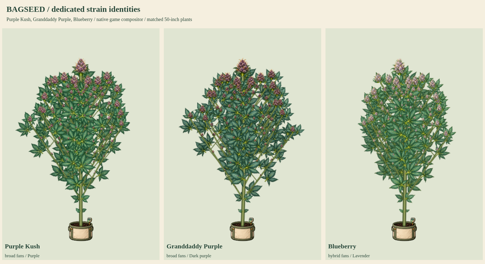

# Purple Kush, Granddaddy Purple and Blueberry

Status: **user-approved and integrated into the production build**. The preceding approved Afghani/Hindu Kush/Bubba Kush update was integrated and pushed as `c303d65`. This batch supplies dedicated artwork for three existing native catalog strains; it adds no catalog entries and changes no genetic, growth or balance values.



- [Flowering detail](flower-detail.png)
- [Late-flower senescence](late-flower-senescence.png)
- [Natural versus cool-night color](cool-night-colors.png)
- Full cycles: [Purple Kush](purplekush-growth.png), [Granddaddy Purple](gdp-growth.png), [Blueberry](blueberry-growth.png)
- [50-inch potted and 90-inch outdoor models](50-and-90-inches.png)
- [Bamboo, SCROG, cleanup and stress](care-and-training.png)
- [Eight-second growth and wind MP4](growth-and-wind.mp4) / [GIF](growth-and-wind.gif)

## Existing native identities

| Strain and native ID | Dedicated artwork | Natural final-week palette | Existing cool-night response |
| --- | --- | --- | --- |
| Purple Kush / `cl_purplekush` | Broad sage-blue fans, plum-purple calyx clusters, silver resin, amber stigmas | Purple | Deeper purple |
| Granddaddy Purple / `cl_gdp` | Broad dusky-blue fans, dense rounded deep-plum flowers, copper stigmas | Deep purple | Near-black purple |
| Blueberry / `cl_blueberry` | Sage-blue hybrid fans, silvery lilac flowers, fine amber stigmas | Lavender | Deeper lavender |

These are artistic interpretations of the game's actual expressed traits, not a promise that every real cultivar or phenotype has identical anatomy. Native leaf palettes remain `blue`; leaf shapes remain broad/broad/hybrid; branching remains 1.05/1.1/1. No native height factor is multiplied into the visual height a second time. Healthy source fan tissue stays blue-green; the existing renderer applies phenotype-aware final-week leaf colors.

Each kit retains sixteen original connected source organs: seed, radicle, cotyledon, single/three/five/seven-leaflet fans, sugar leaf, stem, junction, three female flower stages, two male flower stages and bamboo. PNG pixels are preserved exactly. Crop rectangles, attachment points, alpha hulls, source hashes and exact RGBA-equivalent lossless WebP are recorded by the compiler. No source repainting or recoloring is performed by the compiler.

All three native color identities are already receptive to the existing night-color rule. The study advances the real rule over two selected cycles with a 78F daytime mean: 70F nights earn no exposure, while the inclusive 10F drop to 68F earns 24 qualifying hours, full existing pigment expression and the native 0.08 Sprout bonus. No controller, pigment, virality or climate mechanic is added. Natural senescence remains independent of hunger and stress.

## Preview and checks

The original review mode replaces only the live plant script in a disposable response for current `index.html`. It combines the twenty-one released base kits with these three pending kits and retains seventeen mutation atlases. The 41 atlas images are an asset count, not a strain count. The real recipe resolver selects each dedicated kit by its existing native ID and traits. All plants use the current PlantArt compositor and attachment model. That sample mode leaves published files unchanged. The approved exact sources are now registered under their native IDs and published through the existing external-image pipeline. Production capture verifies the actual built page without sample routes. Compatible living old saves upgrade at create/load/save boundaries without rerolling seeds, traits, genomes or heights; unrelated recipes and historical photos remain pinned.

Checks passed for thirteen renderer stages per family, dedicated leaf/flower selection, connected anatomy, 50/90-inch expansion, larger apical flowers, smaller attached branch/popcorn buds, lower cleanup with enlarged retained tops, all four training modes, supports, SCROG, stress, male flowers, wind, fixed roots, reduced motion, all fifteen mutations per strain (45 combinations), clones, snapshots, save/reload, read-only biological state and preservation of unrelated pinned recipes. All six native cool-night and Sprout bonus cases passed. No browser JavaScript errors were recorded. Static integrity checks pass, including the current character release and external-image hashes.

The growth sheets enlarge seed/radicle component detail and early seedlings for inspection. Matched comparison/expansion boards use explicitly shared physical scales. The wind clip contains 96 frames at 12fps (8 seconds), with selected stage/height inputs; it is not eight seconds of simulated cultivation. Captions are spaced beneath pots in the final capture.

Reproduce:

```sh
python3 tools/compile-plant-components.py purplekush --review-only --review-root=review/strain-batch-09
python3 tools/compile-plant-components.py gdp --review-only --review-root=review/strain-batch-09
python3 tools/compile-plant-components.py blueberry --review-only --review-root=review/strain-batch-09
```

```js
require('./tools/preview-strain-batch-06.cjs')({
  reviewRoot: require('node:path').resolve('review/strain-batch-09'),
  kitKeys: ['purplekush', 'gdp', 'blueberry'],
  animate: true
});
```

The user approved publication and pushing these exact sources on 2026-10-19. Released dedicated coverage is now 22/37 named strains, leaving fifteen. Production verification additionally exercises old living-save upgrades and idempotence with seeds, expressed traits, genomes and physical heights preserved. Next catalog group: Blue Dream, Sour Diesel and Chemdawg. The fifteen mutation types are a separate category from named strains.
