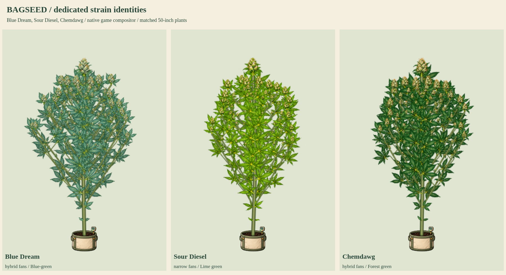

# Blue Dream, Sour Diesel and Chemdawg

Status: **user-approved and integrated into the production build**. The preceding approved Purple Kush/Granddaddy Purple/Blueberry update was integrated and pushed as `06219fc`. This batch supplies original dedicated parts for three existing native catalog lines. No native genetic, growth, timing, yield, climate or breeding values are changed.



- [Flowering detail](flower-detail.png)
- [Late-flower senescence](late-flower-senescence.png)
- [Natural versus cool-night color](cool-night-colors.png)
- Full cycles: [Blue Dream](bluedream-growth.png), [Sour Diesel](sourdiesel-growth.png), [Chemdawg](chemdawg-growth.png)
- [50-inch potted and 90-inch outdoor models](50-and-90-inches.png)
- [Bamboo, SCROG, lower cleanup and stress](care-and-training.png)
- [Eight-second growth and wind MP4](growth-and-wind.mp4) / [GIF](growth-and-wind.gif)

## Actual native traits and dedicated artwork

| Existing strain | Native traits | Dedicated artwork and finishing |
| --- | --- | --- |
| Blue Dream / `cl_bluedream` | hybrid / blue / Blue-green / branching 1 | Sage-blue fans, mint-green resinous flowers, ochre final-week fans; existing eligible cool nights deepen blue-violet pigment |
| Sour Diesel / `cl_sourdiesel` | narrow / lime / Lime green / branching 0.95 | Narrow lime fans, elongated green flowers and orange stigmas; golden finishing without extra purple eligibility |
| Chemdawg / `cl_chemdawg` | hybrid / forest / Forest green / branching 1 | Forest-green fans, dense pale olive bracts, fine white resin and rust-orange stigmas; golden finishing without extra purple eligibility |

These are game-art interpretations of the native expressed traits, not universal diagnostic claims about real cultivars or every phenotype. Healthy source fan tissue stays green/blue-green; the current compositor applies final-week senescence and eligible night pigment. Actual saved height is used without multiplying the existing native height factor a second time.

Each kit contains sixteen original organs: seed, radicle, cotyledon, single/three/five/seven-leaflet fans, sugar leaf, stem, junction, early/mid/late female flowers, closed/open male flowers and bamboo. Original PNG pixels are retained. The compiler measures isolated crops, anchors and alpha hulls, and verifies exact RGBA-equivalent lossless WebP. The first Sour Diesel layout failed crop separation; its final source was refined with the image tool, remeasured and passed. Source alpha is preserved, including transparent edge pixels; no source pixel masking/repainting was done in Python.

The color study advances the actual night-color rule over two selected cycles: a 78F daytime mean with 70F nights earns no qualifying exposure; the inclusive 10F drop to 68F gives receptive Blue Dream 24 qualifying hours, native blue-violet expression and the existing 0.08 Sprout bonus. Sour Diesel and Chemdawg remain ineligible for that pigment bonus under both cases. No additional climate or social mechanic is introduced.

## Native renderer preview and checks

The original sample mode replaces only the live plant script in a disposable response for current `index.html`. The sample combines twenty-four released base kits with these three pending kits and retains seventeen mutation atlases. The 44 atlas images are an asset count, not a strain count. Actual native recipe selection, attached anatomy and PlantArt compositing draw the samples; no whole-plant illustration is pasted over gameplay. Published HTML, public assets, approved production manifests, character release, native catalog and phenotype library remain unchanged during this review.

Checks passed for all thirteen renderer stages per strain, automatic dedicated leaf/flower selection, connected organs, 50/90-inch expansion, graded apical/lateral/popcorn buds, lower cleanup and enlarged retained tops, four training modes, supports, SCROG, stress, both flower sexes, fixed-root wind, reduced motion, all fifteen mutations on each strain (45 combinations), cloned/snapshotted recipes, save/reload, read-only biological state and preservation of unrelated pinned donor recipes. All six native cool-night/expression/Sprout cases passed. There were no browser JavaScript errors. `npm run check` passes, including current character-release and external-image integrity checks.

The cycle sheets enlarge seed/radicle component detail and young seedlings for inspection. Matched comparison and 50/90-inch boards use shared physical scales. The animation contains 96 frames at 12fps (eight seconds), with selected stage/height inputs illustrating growth rather than eight seconds of simulated cultivation.

Reproduce:

```sh
python3 tools/compile-plant-components.py bluedream --review-only --review-root=review/strain-batch-10
python3 tools/compile-plant-components.py sourdiesel --review-only --review-root=review/strain-batch-10
python3 tools/compile-plant-components.py chemdawg --review-only --review-root=review/strain-batch-10
```

```js
require('./tools/preview-strain-batch-06.cjs')({
  reviewRoot: require('node:path').resolve('review/strain-batch-10'),
  kitKeys: ['bluedream', 'sourdiesel', 'chemdawg'],
  animate: true
});
```

The user approved and requested pushing these exact sources on 2026-10-19. Released dedicated coverage is now 25/37 named strains, with twelve remaining. Production verification additionally exercises old living-save upgrades and idempotence while preserving seeds, expressed traits, genomes and physical heights. Next catalog group: Jack Herer, Durban Poison and Trainwreck. The fifteen mutation types are separate from named strains.
