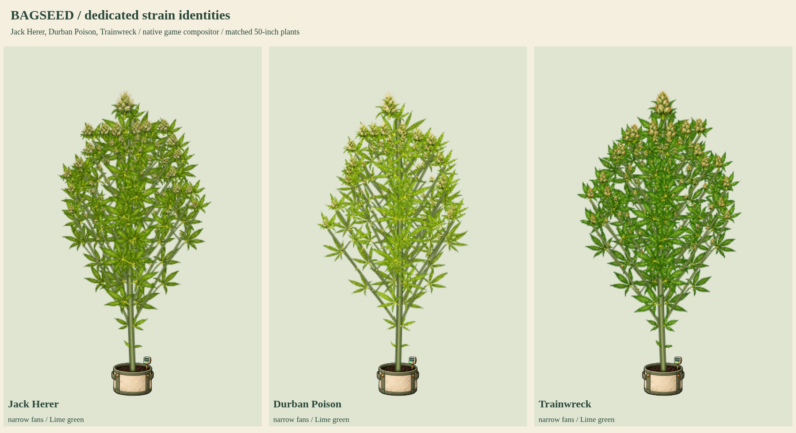

# Jack Herer, Durban Poison and Trainwreck

Status: **user-approved production artwork, integrated into index.html**. The preceding approved Blue Dream/Sour Diesel/Chemdawg update was integrated and pushed as `eecd2e7`. These three new dedicated kits map to existing native catalog identities without adding strains or changing genetics, growth, timing, yields, climate or breeding behavior.



- [Flowering detail](flower-detail.png)
- [Late-flower senescence](late-flower-senescence.png)
- Full cycles: [Jack Herer](jackherer-growth.png), [Durban Poison](durban-growth.png), [Trainwreck](trainwreck-growth.png)
- [50-inch potted and 90-inch outdoor models](50-and-90-inches.png)
- [Bamboo, SCROG, lower cleanup and stress](care-and-training.png)
- [Eight-second growth and wind MP4](growth-and-wind.mp4) / [GIF](growth-and-wind.gif)

## Existing native traits and artwork

All three native lines express narrow / lime / Lime green traits, so this batch keeps healthy green foliage and natural golden final-week senescence. No purple/blue night-color eligibility is invented to make the artwork different. Native branching remains 0.95 / 0.9 / 0.95. Their existing native height factors and timing are retained; the renderer uses actual saved height without applying a height multiplier twice.

| Native line | Dedicated original source identity |
| --- | --- |
| Jack Herer / `cl_jackherer` | Narrow lime-green fans, pale frosted tapered flower clusters, fine ivory/amber stigmas |
| Durban Poison / `cl_durban` | Finer lime-green leaflets, more open foliage and elongated lighter flower clusters |
| Trainwreck / `cl_trainwreck` | Angular narrow lime-green fans, denser pointed green bracts, resin and copper-orange stigmas |

These are artistic interpretations of the game's expressed traits, not diagnostic claims that all real cultivars or phenotypes have identical shapes. New source sets provide separate leaf and flower silhouettes and texture while sharing the connected growth/attachment system. Each atlas retains sixteen original organs: seed, radicle, cotyledon, single/three/five/seven-leaflet fans, sugar leaf, stem, Y junction, early/mid/late female flowers, closed/open male flowers and bamboo. Source PNG pixels are preserved. The compiler measures isolated nonoverlapping crops, anchors and alpha hulls, and verifies exact RGBA-equivalent lossless WebP.

## Native renderer preview and verification

The preview replaces only the live plant script in a disposable response for current `index.html`, adding these three pending kits to twenty-seven released base kits while retaining seventeen mutation atlases. The resulting 47 images are an asset count, not a strain count. Actual native recipe selection, PlantArt compositing and attached anatomy render all samples. Published HTML, public assets, approved production manifests, character release, native catalog and phenotype library remain unchanged by this sample.

Checks passed for thirteen renderer stages per strain, automatic dedicated leaf/flower selection, connected organs, 50/90-inch expansion, larger tops and smaller attached lateral/popcorn buds, lower cleanup with larger retained flowers, all four training modes, bamboo, SCROG, stress, both flower sexes, fixed-root wind, reduced motion, all fifteen mutations on each strain (45 combinations), clones, snapshots, save/reload, read-only biological state and preservation of unrelated pinned donor recipes. There were no browser JavaScript errors. `npm run check` passes, including the current character release and external-image hashes.

The cycle sheets enlarge seed/radicle component detail and early seedlings for inspection. Matched comparison and expansion boards use explicit shared physical scales. The clip contains 96 frames at 12fps (eight seconds); stage/height values are selected review inputs, not eight seconds of simulated cultivation.

Reproduce:

```sh
python3 tools/compile-plant-components.py jackherer --review-only --review-root=review/strain-batch-11
python3 tools/compile-plant-components.py durban --review-only --review-root=review/strain-batch-11
python3 tools/compile-plant-components.py trainwreck --review-only --review-root=review/strain-batch-11
```

```js
require('./tools/preview-strain-batch-06.cjs')({
  reviewRoot: require('node:path').resolve('review/strain-batch-11'),
  kitKeys: ['jackherer', 'durban', 'trainwreck'],
  animate: true
});
```

Exact approved source kits are promoted, with native `cl_` mappings and compatible living-save artwork upgrades. Released dedicated coverage is 28/37 named strains, with nine remaining. Production gates 30 base plus 17 mutation atlases. Next catalog group: AK-47, Super Silver Haze and Super Lemon Haze. The fifteen mutation types are a separate category from named strains.
