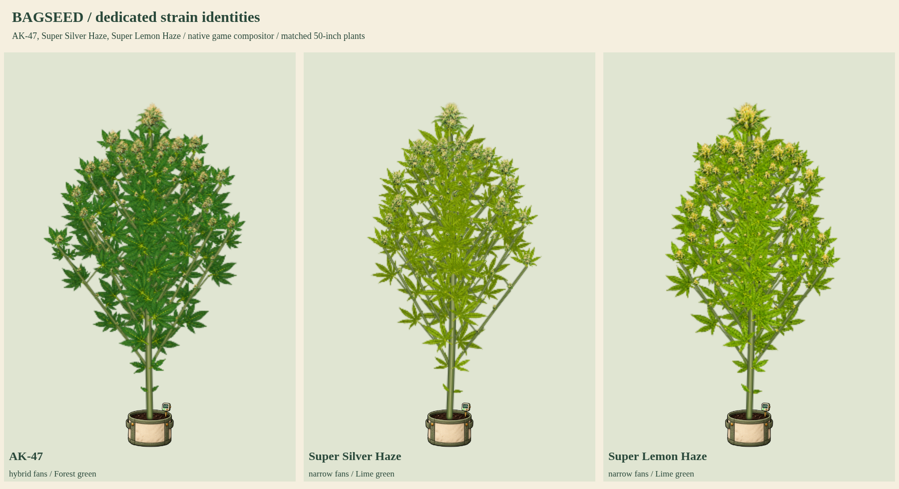

# AK-47, Super Silver Haze and Super Lemon Haze

Status: user-approved production artwork, integrated into index.html. Previous approved batch Jack Herer, Durban Poison and Trainwreck was published as `a7ae265`.

These three existing native strains retain their expressed genetics and growth behavior. AK-47 keeps hybrid forest-green foliage and native branching 1. Super Silver Haze and Super Lemon Haze keep narrow lime-green foliage and branching 0.9. All three use golden final-week fan senescence; no extra purple/blue night-color eligibility is added.

Each source atlas contains sixteen original organ silhouettes from seed/root through female and male flowering, plus bamboo. Crop bounds, attachment anchors and alpha hulls are measured from original pixels; WebP must decode to exactly the same RGBA image. Shared connected rendering preserves expansion, anatomy, graded apical/lateral/popcorn buds, cleanup, training, stress, supports, all fifteen mutations, fixed-root wind and saved identity.

The review uses current index.html with only disposable plant-script/image response overrides. Production files, published character release and game biology remain unchanged by these samples. Production coverage is now 31/37 named strains, leaving six. Startup gates 33 base plus 17 mutation atlases. Experimental phenotype kits and mutation atlases are separate from strain counts.

## Preview files

- [Flower detail](flower-detail.png) and [late-flower senescence](late-flower-senescence.png)
- Full cycles: [AK-47](ak47-growth.png), [Super Silver Haze](ssh-growth.png), [Super Lemon Haze](slh-growth.png)
- [50/90-inch expansion](50-and-90-inches.png) and [care/training](care-and-training.png)
- [Eight-second growth and wind animation](growth-and-wind.mp4)

Reproduce component measurement with `python3 tools/compile-plant-components.py ak47 --review-only --review-root=review/strain-batch-12` (repeat for ssh/slh). Render through `require('./tools/preview-strain-batch-06.cjs')({reviewRoot:require('node:path').resolve('review/strain-batch-12'),kitKeys:['ak47','ssh','slh'],animate:true})`.

The samples illustrate interpretations of the existing game traits, not universal diagnostic characteristics of real cultivars. Stage and height inputs in the eight-second clip are review selections rather than eight seconds of simulated cultivation.

Validation passed: thirteen stages per strain; all fifteen mutations on each strain (45 combinations); 50/90-inch expansion; graded buds and lower cleanup; four training forms; stress, supports, female/male flowers; wind/reduced motion; clones, snapshots and save/reload; read-only biology; unrelated donor recipes preserved. Browser errors: none. Static integrity checks and retained character-release checks pass. The 96-frame MP4 runs at 12fps (eight seconds).
