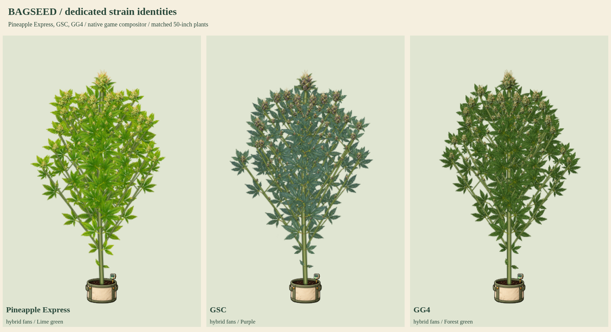

# Pineapple Express, GSC and GG4

Status: user-approved production artwork, integrated into index.html. Approved AK-47, Super Silver Haze and Super Lemon Haze were published as `0bb3673`.

The new source kits target existing native catalog lines without changing simulation genes, growth, timing, yields or breeding. Pineapple Express retains hybrid/lime/Lime green traits and branching 1; GSC hybrid/blue/Purple and branching 1.05; GG4 hybrid/forest/Forest green and branching 1.05. Only GSC retains receptive purple night-color expression; the other two retain natural golden final-week senescence. Illustrations interpret these expressed game traits rather than claiming universal cultivar diagnostics.

Each atlas contains sixteen original isolated organs from seed and root through female/male flowering, plus bamboo. Compiler measurements retain original pixels and verify separated crop bounds, anchors, hulls and RGBA-exact WebP. The same connected compositor retains expanding branches, graded tops/lateral/popcorn flowers, pruning, training, supports, stress, senescence, fifteen mutations, fixed-root wind, reduced motion, clones, snapshots and saves.

Review rendering temporarily overrides only plant-script/image responses for the current index.html. Production HTML, assets, published character payload and biological state remain unchanged by the sample. Released coverage is now 34/37 named strains, leaving Harlequin, Cannatonic and ACDC. Production gates 36 base and 17 mutation atlases. Experimental phenotype kits and mutation atlases are separate categories.

- [Flower detail](flower-detail.png), [late-flower senescence](late-flower-senescence.png), [cool-night colors](cool-night-colors.png)
- Full cycles: [Pineapple Express](pineexpress-growth.png), [GSC](gsc-growth.png), [GG4](gg4-growth.png)
- [50/90-inch expansion](50-and-90-inches.png), [care and training](care-and-training.png)
- [Eight-second growth/wind clip](growth-and-wind.mp4)

Reproduce atlas measurement with `python3 tools/compile-plant-components.py pineexpress --review-only --review-root=review/strain-batch-13` (repeat for gsc and gg4). Render using `require('./tools/preview-strain-batch-06.cjs')({reviewRoot:require('node:path').resolve('review/strain-batch-13'),kitKeys:['pineexpress','gsc','gg4'],animate:true})`.

Validation passed: thirteen stages per strain, 50/90-inch expansion, connected and graded flowers, lower cleanup, four training modes, stress, supports, both flower sexes, fixed-root wind and reduced motion, all fifteen mutations per strain (45 combinations), clones, snapshots, save/reload, read-only biology and unrelated pinned donor recipes. Six native cool-night cases pass, with only GSC receptive at the existing inclusive threshold. No browser errors. Static checks pass and the current character release remains intact. Animation: 96 frames at 12fps, eight seconds; stage/height changes are selected review inputs.
