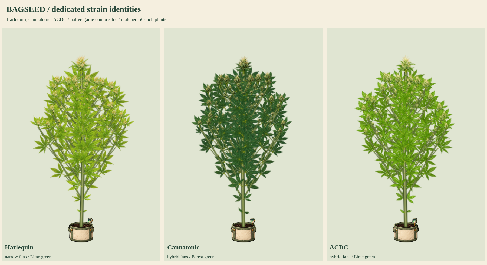

# Harlequin, Cannatonic and ACDC

Status: user-approved production artwork, integrated into index.html.

These are the final three existing named catalog strains needing dedicated component art. Released dedicated coverage is now 37/37 named strains. Production gates 39 base plus 17 mutation atlases. Experimental phenotype profiles, random Bag Seed and mutation atlases are separate categories.

Harlequin retains native narrow/lime/Lime green traits and branching 0.95. Cannatonic keeps hybrid/forest/Forest green and branching 1. ACDC keeps hybrid/lime/Lime green and branching 0.95. All retain natural golden final-week senescence, with no invented extra purple eligibility. No genetic, growth, timing, yield, breeding or climate simulation values change.

Each source atlas contains sixteen original isolated organs from seed and root through female/male flowering, plus bamboo. Crop bounds, attachment anchors and alpha hulls are measured from original pixels; lossless WebP must decode identically. Shared connected rendering retains expanding branches, graded apical/lateral/popcorn flowers, pruning, training, supports, stress, senescence, all fifteen mutations, fixed-root wind, reduced motion, clones, snapshots and saves.

The review uses current index.html with only disposable plant-script/image response overrides. Production files, published character release and game biology remain unchanged by the samples. Illustrations interpret expressed game traits rather than claiming universal cultivar diagnostics.

- [Flower detail](flower-detail.png), [late-flower senescence](late-flower-senescence.png)
- Full cycles: [Harlequin](harlequin-growth.png), [Cannatonic](cannatonic-growth.png), [ACDC](acdc-growth.png)
- [50/90-inch expansion](50-and-90-inches.png), [care and training](care-and-training.png)
- [Growth and wind animation](growth-and-wind.mp4)

Reproduce measurement with `python3 tools/compile-plant-components.py harlequin --review-only --review-root=review/strain-batch-14` (repeat for cannatonic and acdc). Render with `require('./tools/preview-strain-batch-06.cjs')({reviewRoot:require('node:path').resolve('review/strain-batch-14'),kitKeys:['harlequin','cannatonic','acdc'],animate:true})`.

Previous approved batch was pushed as `0e8035b`. Validation passed: thirteen stages per strain; 50/90-inch expansion; connected organs and graded flowers; lower cleanup; four training forms; stress, supports, both flower sexes; fixed-root wind and reduced motion; all fifteen mutations per strain (45 combinations); clones, snapshots, save/reload; read-only biology and unrelated pinned donor recipes. No browser errors. Static integrity checks and retained character-release checks pass. The clip contains 96 frames at 12fps (eight seconds); stage and height values are selected review inputs.

ACDC alignment revision: the mid-flower attachment now explicitly targets source pixel (1092, 901), the central stem, instead of the dangling side leaflet detected at the sprite bottom. Source image pixels are unchanged. `attachmentPoints` in the profile is validated against the crop and opaque alpha during compilation, so review and eventual production builds use the same correction. Cycle, finishing and wind previews were regenerated and all native-renderer checks passed again.
